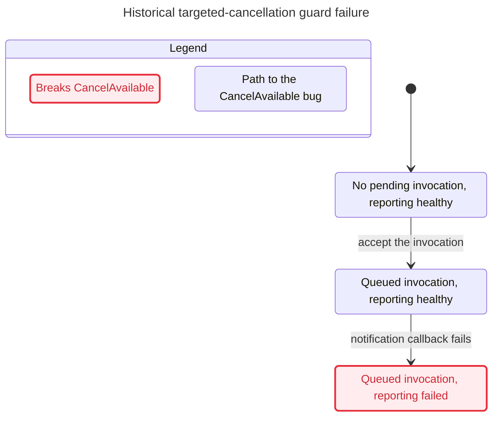

# Agent session lifecycle contract

> **Frame redesign scope.**
> [Session frames](../../packages/agent/docs/session-frames.md) specifies the
> implemented reducer and storage grammar. The models below do not cover frame
> transactions, context edits or harness-defined execution. This page's current
> targeted-cancellation finding is unchanged.

This specification defines the intended post-startup contract for agent
sessions. It also records where the current implementation does not satisfy that
contract. It does not certify the Zig implementation.

The executable checks are `SessionLifecycle.tla`, `RunSlots.tla`, and
`KeyedEffect.tla`. `Startup.tla` remains the startup specification. The new
models begin after a Worker is published. There is no checked composition or
implementation refinement theorem between these models.

## State and identity

| Model              | State                                                                                                                                                | Identity                                                                          |
| ------------------ | ---------------------------------------------------------------------------------------------------------------------------------------------------- | --------------------------------------------------------------------------------- |
| `SessionLifecycle` | Controller admission, Worker health, queued and running requests, terminal outcomes, reporting, cancellation, outstanding jobs, and joined shutdown. | Two distinct request IDs, each admitted at most once.                             |
| `RunSlots`         | An active run, a suspended run, and outstanding continuation tokens.                                                                                 | One user run, one auxiliary compaction run, and two unique suspension tokens.     |
| `KeyedEffect`      | Exclusive intent creation, durable intent, external dispatch, receipt writing, acknowledgement, and interrupted recovery.                            | One fixed process-execution key and matching arguments, with at most two crashes. |

A request ID is not a run identity. `domain_ops.yieldContext` completes a
command while retaining its suspended run. `RunState.resumeRun` gives that run a
new command ID. The separate models preserve this distinction. The auxiliary run
can occupy `active` while the user run occupies `suspended`.

Cancellation is a request to stop. A terminal cancelled request can still own a
host job that has not joined. Its external effect may already have happened.
Cancellation does not mean rollback.

## Session transitions

| Action                                      | Meaning and implementation correspondence                                                                                                                                                                                                                                                             |
| ------------------------------------------- | ----------------------------------------------------------------------------------------------------------------------------------------------------------------------------------------------------------------------------------------------------------------------------------------------------- |
| `Admit`                                     | Accept a new request into the queue. `Controller.State.admitCommand`, `Runtime.submitRawRegistered`, and `logic.admitOne` implement different admission stages. The model abstracts successful admission and omits allocation and policy evaluation.                                                  |
| `Start`                                     | Start one queued request when the active position is free. `logic.advance` and `work.advance` schedule execution. Already-admitted work can start after Controller admission closes, before the actor processes stop.                                                                                 |
| `StartJob`, `JoinJob`                       | Acquire and retire an outstanding operation. `Runtime.drain`, `Job.own`, the actor's `.complete` branch, and `Runtime.destroy` own these lifetimes. Each request has one representative outstanding job in this model.                                                                                |
| `Finish`                                    | Publish a terminal command result after its ordinary operation has finished. `logic.finish`, `domain_ops.complete`, `work.completeProgram`, and `Session.stage` own the result and journal transition.                                                                                                |
| `Cancel`, `SettleCancel`                    | Accept stopping intent, then settle the request separately from joining its jobs. `Controller.cancelInvocation`, `logic.control`, `Session.cancelExternal`, and `work.stop` provide the corresponding operations. The model excludes submission allocation failure.                                   |
| `RetireForReplacement`                      | Retire the old queued or running request without waiting for its obsolete operation to join. The replacement starts in a separate step. `logic.control` marks an obsolete operation before staging cancellation. `Session.feedLate` records late replies without applying them to the new active run. |
| `FailSink`, `Report`                        | Fail notification delivery and report the execution outcome independently. Framework `Runtime.settleFinished` and `Controller.State.deliver` separate these concerns. Minimal's `invoke` still waits for delivery before examining the execution result.                                              |
| `NeedRecovery`, `Recover`                   | Enter explicit recovery and either regain health or become faulted. These are intended client protocol transitions. Minimal's `invoke`, `recoverInterrupted`, and `refresh` do not yet implement this explicit state machine. These actions are not claimed to be existing atomic Zig transitions.    |
| `Fault`                                     | Make the Worker unusable and settle pending observations as failed. `Session.fault` and `Runtime.settleFailure` implement the low-level failure boundary. The model's terminal history is a ghost record of observations, not a promise that every fatal failure could be journalled.                 |
| `Close`                                     | Close admission. `Controller.State.requestClose` changes the gate under its mutex. This does not atomically stop Workers or external operations.                                                                                                                                                      |
| `StopWorker`                                | Deliver stopping intent to the actor. `Runtime.destroy` sends stop and `Runtime.run` processes it. The model abstracts the subsequent request failures as cancellation settlement. It does not claim that `WorkerStopped` is the native cancelled-result tag.                                         |
| `JoinActor`, `JoinNotifications`, `Release` | Join execution and callbacks before releasing borrowed contexts. `Runtime.destroy`, `Controller.State.destroyWorker`, and `Controller.State.close` establish these boundaries. Actual adapter and `std.Io` join contracts remain assumptions.                                                         |

The source anchors are a manual correspondence record. Some actions abstract
several implementation steps. None of these rows establishes that all
intermediate Zig states refine one TLA+ action. In particular, asynchronous
admission, journal appends, and client recovery need a concrete refinement map
before claiming implementation verification.

## Native login and provider replacement

Minimal `Controller.setProvider` composes existing gateway close and Worker
launch operations while no model invocation is active. It prepares a candidate
gateway, joins the old gateway, and then opens the replacement Worker against
the same journal. A failed launch attempts to reopen the previous provider.
Candidate and restored gateways retain their borrowed service contexts until
close returns. This is manual source correspondence, not an atomic provider-swap
action or a refinement theorem.

The TUI owns a device-login future and a separate `model_registry.Refresh`
cache. Device login owns a private credential-store descriptor and arena,
persists authorization before publishing success, and does not mutate the UI's
credential store. The UI reloads credentials after joining. Model discovery does
not change the selected route, and closing the post-authorization picker retains
the saved login. The registry cache uses the harness's already-bound credential
targets; route removal and shutdown join discovery work before releasing its
borrowed contexts. Closing a picker does not cancel work for a still-configured
route. These tasks are outside `SessionLifecycle`'s representative Worker job;
the model does not verify discovery, OAuth, credential persistence, or
refresh-token rotation.

## Minimal UI queue and process observation correspondence

The resume picker reads published journals. An inactive rename takes that file's
writer locks and commits the display title and name extension in one journal
transaction. A confirmed deletion checks the selected inode under the writer
locks, keeps them through the removal, and synchronizes the parent directory
before reporting success. The active session uses its existing passive title
admission. Offline journal edits, file identity, and trash behavior are outside
these Worker models.

Minimal keeps an explicitly paused inbox and can hold pending inputs after a
failed run. Pending follow-ups are journaled inbox entries awaiting a claim.
Queue Continue re-enters ordinary Controller admission for paused or held
inputs. An empty pending queue shows no paused banner. These UI states are
outside the finite Worker model.

Minimal publishes steering and follow-up preferences together in the
Controller's atomic run policy. Live and provisional application claims read
that policy through the Worker bindings. The inbox returns a recorded claim
before selecting pending entries under the current mode. The bindings borrow the
Controller through Worker join. Queue batch size and preference changes are
outside the model's admission actions.

Terminal queue restoration stages the replacement draft and then withdraws
pending steering and follow-ups in one inbox revision.
`Controller.withdrawPendingMessages` uses the captured worker and inbox head and
shares `steering_mutex` with native steering admission. A concurrent claim
changes the head and forces the UI to rebuild its draft from the remaining
pending messages. `App.abort` requests cancellation and joins execution even if
restoration fails. The editor draft remains in memory. The finite Worker models
cover lower-level cancellation and omit the inbox withdrawal and editor
publication.

Services `Exec.observe` copies bounded provisional output through a
descriptor-lifetime mutex. Tracking occurs only within an already-authorized
dispatch after process spawn; tracking allocation failure cannot fail or retry
execution. Untracking precedes descriptor closure and borrowed service teardown
follows gateway join. Observations neither create effects nor publish durable
receipts; the keyed intent/receipt ordering and uncertainty rules are unchanged.

Minimal's terminal owner starts an explicitly submitted shell command in a
separate joined job. `Exec.captureInteractive` uses the existing keyed dispatch
with a distinct terminal key and observation identity. Cancellation joins
process-group cleanup before reading any retained output. The application then
records the result through a passive conversation write. Only `!` has a
user-role projection. This projection cannot activate the inbox. Shell input,
deferred card placement, and partial output from cancellation are outside the
finite models.

Interactive replacement prepares and validates the destination journal before
touching the outgoing UI jobs. The UI joins its model and shell jobs and waits
for the outgoing shell write before `Controller.changeSession` closes the old
scheduler and Worker. Dismissing a picker never enters this sequence. This is
manual source correspondence for UI ownership and placement outside the finite
Worker models.

When the locked destination journal names a different workspace, Minimal
validates the directory and builds a separate Controller after settling the
outgoing foreground work. Its workspace configuration, service bindings, task
callbacks, and provider route belong to the destination. The UI joins outgoing
discovery and completion jobs and detaches the event sink before releasing the
old Controller and its arena. The native workspace handoff and filesystem checks
are outside the finite Worker models.

When the destination workspace is missing, the choice dialog holds the prepared
journal lease through confirmation. Continue once revalidates that file and
supplies the current directory to the destination Controller while retaining the
durable workspace in its application configuration. Fork revalidates and stages
a fresh journal from committed application entries and the recorded selection.
Historical tool results are embedded as history data. Request, inbox, task, and
effect operations stay in the original journal. Cancel releases the prepared
lease while the outgoing Controller remains active. These archive and UI
transitions are outside the finite Worker models.

Startup resolves session paths, IDs, and picker selections before binding
workspace services or launching a Worker. The startup picker uses published
journal views and releases its terminal and loader resources before a selected
file is prepared for writing. Missing-workspace recovery retains that prepared
lease until selection or cancellation. Startup consumption transfers that lease
into the Worker. This is manual correspondence for the CLI and terminal path
before the finite startup model's runtime actions.

Launch file arguments are read and their images prepared before the CLI opens
the session. The prompt inbox saves the first turn's text and image parts
together. Keyed admission hashes the image parts along with the prompt identity.
Claims and recovery carry the saved payload to the existing user entry, so a
reopened session can replay it after the source file changes or is removed. This
changes the prompt payload and its validation. The finite models abstract that
payload and have no file-attachment states.

History browsing obtains the selected head through Controller's context-snapshot
API and holds its own immutable page arena, separate from live stream cards. CLI
option grammar and these presentation states are outside the finite
startup/session models. No run-slot writes, formal actions, bounds, invariants,
or fairness assumptions changed. Native regressions cover paused queues,
original-draft preservation, output observation and joined cancellation; model
checks remain evidence only for the checked specifications.

## Read-only journal correspondence

`SessionJournal.append` writes the follower boundary after journal sync and
candidate adoption. The reader follows that boundary without owning the writer
lock or starting a Worker. A crash before publication can leave complete bytes
past the reader's boundary. Writer reopen validates and synchronizes any newly
recovered prefix before making it visible to followers. Viewer publication is
outside the checked configurations and the Lean publication kernel.

## Provider recovery correspondence

Minimal prepares new built-in Read images inside the admitted `files.read`
operation. Image processing receives the owned byte snapshot after the file has
closed and the shared file mutex has been released. The effect is still
read-only. The image runtime outlives worker teardown, and this processing does
not revisit saved images. The host job model leaves codec computation and its
cooperative cancellation boundaries to native verification.

Minimal's startup configuration stores any launch-only model selection with the
matching application configuration in one checkpoint. New launches still read
the saved preference. Scoped task model binding reads the effective selection at
the fork or ownership cut. Route selection and historical scope binding use
source review and binary fault injection.

DeepSeek now uses typed provider options and a distinct `deepseek` credential
label across startup, saved login and model switching, instead of copying
credentials into OpenAI environment variables. Admitted routing still checks
both endpoint and credential label before transport IO. Explicit endpoint
overrides stay provider-scoped; saved credentials must match the selected
provider endpoint before an explicit override can apply. Provider snapshots copy
identity together with owned strings. This is source correspondence for existing
admission/ownership boundaries, not a new model action. No run-slot or
external-effect replay semantics changed.

Provider route retries remain inside one admitted `model.request` service
operation. They do not submit the user's input again, reopen the turn, or replay
completed tools. HTTP/SSE/WebSocket interruption before a committed model result
can retry generation after a cancellable delay. A `retrying` notification
replaces only provisional previews; ordinary terminal outcomes remain separate.
Network attempts and retry counters are not explicit model variables: this is
manual correspondence to `StartJob`/`JoinJob`, not a new atomic recovery
theorem.

Minimal's Codex transport can switch from WebSocket to SSE inside the same
admitted provider operation. A successful exchange can return its connection to
the session cache after the request watchdog joins. An interrupted exchange
discards the socket before the fallback checks cancellation and starts SSE. Any
WebSocket data frame ends eligibility for replay, including a partial frame. An
interruption records the admitted session ID in a process-local set used for
later requests and retires that session's cached sockets.

Worker dispatch and native task dispatch borrow the session ID through their
existing joined lifetimes. `Controller.destroyWorker` retires the session's
sockets after joining both forms of dispatch. `CodexSessions` owns the sticky
set and cache through process shutdown and joins the idle timer before cleanup.
The lifecycle model treats both exchanges as one host job and leaves socket
leases, watchdogs, and idle expiry to native verification.

A cached Codex request can omit a verified input prefix on the same socket. If
the provider explicitly rejects the cached ID before output, the attempt joins
the watchdog and discards that socket before resending the already prepared full
payload. This recovery is inside the same admitted host job. The transport
preference is sampled for each fresh admitted request and stays fixed across its
internal attempts and credential refreshes.

Minimal uses the provider operation for native stream resumption and handles
fresh retries in its application. It commits a failed attempt and a pending
retry, then stores the wall-clock deadline before waiting. The native actor can
accept inbox writes during that wait. The inbox extension and the user's first
durable conversation entry share a commit when the application accepts a prompt.
These junctions are outside the existing models' state variables.

An active provider poll commits its next deadline and consecutive failure count
as progress on the original model request. Minimal's Worker then commits a
waiting command receipt, and the scheduler converts that receipt to a sleeping
task. A restart between those commits reads the existing receipt. A restart
before the Worker receipt uses provider progress to recover the pending request.
The model request is still open during sleep. Cancellation can therefore use its
saved response identity without reopening the old transport operation. The
finite lifecycle checks do not model the task graph, these polling transitions,
or the external provider.

A compaction hook runs on a scheduler task after the application commits the
selected range. The task checkpoints a decline, a replacement summary, or the
decision to use the provider before the application resumes. The application
checks that the decision still matches the saved cut before applying it. A
decline at the threshold is saved with the run so a restart can proceed to
generation. The finite models omit the hook task and the compaction cut. Their
source correspondence uses the journal and scheduler boundaries above.

Manual compaction snapshots committed application state while foreground work
can run. Its final handoff settles the compaction datagram and admits a
background write task with its inbox entry in the same transaction. The write
records placement or staleness at the usual application boundary. These
concurrent transitions are outside the finite model state.

The terminal tracks its manual compaction task through summary placement and
buffers composer submissions until that task settles. An inbox transition
preserves still-pending steering before cancelling the old turn. Summary
placement updates the context without activating the inbox. Terminal compaction
admission records a wait marker, which the next seed admission or an explicit
queue resume clears. The oldest buffered input seeds the next turn, and the idle
inbox claim places the seed and the initial steering batch. Recovery reads an
existing claim with the seed first. Escape targets the selected compaction task.
The terminal buffer, wait marker, and delivery policy are outside the finite
models.

Generation preparation records the cut it considered for background compaction.
The Worker checks the conversation's current task graph in that commit and
admits background work only when no compaction is live. The background task
saves retry and summary progress and uses the write path described above. The
finite models omit this admission and its ownership scope.

The Controller and Luau read the same auto-compaction preference before
selecting new automatic work. A setting change leaves a committed background
request, an admitted foreground compaction, and a manual compaction on their
existing continuation paths.

For model-issued tools, the before-tool task checkpoints its decision before the
application can publish tool intent. The application stages the raw result
before the after-tool task starts. The final tool entry consumes the staged
result, preserving the underlying effect observations. Image-bearing results
also use this phase when no after-tool hook is configured. The cancellable image
transform runs on the chosen result before the decision checkpoint. Resumption
consumes that decision. Cancellation joins the transform before cleanup can
settle a staged result using its original attachments. These hook phases use the
existing recovery and keyed-effect boundaries. The finite models have no hook
states.

During foreground cancellation, the task scheduler joins the tool phase before
the foreground cleanup plans outstanding results. The cleanup saves individual
hook decisions in task documents before appending results. Summary cleanup hands
its saved provider identity to a detached cancellation task in the same
transition that retires its progress. These task-graph transitions are outside
the finite lifecycle model state.

Generation hooks use the same scheduler handoff. The application persists the
request input, terminal model reply, or committed tool-round entry IDs before
the hook task runs. The terminal reply keeps its original model request
reference until classification publishes the matching assistant entry and model
finish. A before-request replacement projects into an isolated model context.
The finite models abstract the request projection and the handoff; source review
and native replay cover those boundaries.

When a provider ends an ordinary generation at its output-token limit, the
interpretation keeps the `length` reason and projects assistant text for replay.
Tool items from that provider reply stay in the effect receipt. The generation
settles through the existing answer transition and commits the same response
association after a hook or reopen.

The scheduler publishes wake demand from the committed task graph. With a host
wake callback the scheduler waits for a signal instead of arming its own sleep
timer. Resume rechecks the current clock and obtains the same journal lease used
by automatic scheduling. The finite models omit the clock, task graph, and host
callback. Native replay checks the host wake handoff and the committed deadline
separately from model checks.

Controller shutdown waits for startup admission to drain, then acquires the same
mutex that protects the last startup call's release. The idle signal can reach
close while that call still holds the mutex.

Custom deferred adapters use the same model progress frame with a stable adapter
ID and a typed JSON handle. The Worker keeps the original route, credential
identity, and model attempt. It checkpoints rotations and retry deadlines before
the task parks. Durable cancellation uses the latest committed handle. These
adapter handoffs use source review and binary fault injection and are outside
the state represented by the finite models.

For a disconnected live stream, the same handoff mechanism persists the stream
cursor and the reattachment deadline. It resumes the original response through
the same provider route. Failure to reattach records the move to retrieval
before the attempt yields. The Worker recovery marker and the running
application both use the same model-request reference.

At recovery, `LuauJournalIO` uses that reference to obtain the model frame and
original effect arguments. Before dispatch, Controller authorizes the request
against its original binding. The current launch's selection applies to fresh
attempts. A legacy request can resolve its route from the Minimal configuration
at the request's journal cut when the recorded route and model match. The finite
lifecycle models omit credential resolution and provider request contents.

Minimal admits explicit continue and reset through its durable inbox. Continue
associates each claimed follow-up with that continuation before placing the
batch. The application commits placement and the new run together, and a
cancelled preparation releases the claims. Reset claims at a turn boundary. Its
application checkpoint commits the new context head, inbox consumption, and the
stopped run's settlement together. The existing finite Worker models cover
lower-level admission and joined cancellation. The inbox claims, context edits,
and tool-round boundary use manual source correspondence and native fault
injection.

Minimal claims a direct prompt on the Worker actor before its application entry
can commit. A host withdrawal uses the same extension head. A winning withdrawal
prevents the claim, and a durable claim survives a restart until placement or
cancellation. The prompt entry and the placement receipt share an application
checkpoint. Passive writes pending at a failed run are held in that run's
terminal checkpoint. A later context-changing write or input can place them.
These inbox details are outside the finite Worker models.

The idle inbox boundary can also select queued user inputs. A direct input
checks for earlier pending items before claiming itself. A contextual write can
publish the next run with the write task as its owner. That publication commits
the input and write placements and their receipts in the same checkpoint. The
write task's owned phases can run after reopen, with the recorded selection and
checkpoint. This is manual correspondence for the application journal and task
graph.

For an eligible idle admission, the same actor previews the caller's extension
writes and executes the Luau placement path without external effects. The final
journal transaction contains the task admission, entries, receipts, and
application checkpoint. Failed validation discards the plan. The actor publishes
the in-memory checkpoint and progress notices after the journal commit. A
duplicate transaction reuses the recorded placement. This is manual
correspondence for the caller's atomic admission boundary.

The inbox contract reads the committed conversation run when it validates a
policy-bearing input. The proposed task, input, and other transaction actions
are discarded together on refusal. After-run work counts as a live run. The
finite Worker model has no conversation-level busy or steering state. These
rules use manual source correspondence and native validation. An embedding host
can enable root scheduling without holding a foreground wait. Cancellation
resolves the owner from the saved run or interrupted invocation and submits a
task abort, including during a live provider request or a retry wait. The finite
Worker model covers targeted cancellation at the Worker boundary.

The failure checkpoint can also hold pending user inputs. A task for a held
input can finish without placing it, while the datagram remains available to a
later final boundary. Reopen restores the hold from the inbox. Each selected
input's requested model is available from its datagram or prior task admission.
The run checkpoint preserves the selected model for the model phase.

For older inbox records, the bootstrap planner reads the prior journal before
startup publication. The restored pending holds and the migration marker are
part of the same startup transaction as the approved configuration. Current
claims remain available to their existing recovery path. This is manual
correspondence for the journal upgrade and publication boundary.

Minimal can settle a display-only admission on the Worker actor while a model or
tool operation is outstanding. The admission transaction records the transcript
entry and publishes the consumed datagram together. A queued reset keeps the
draft pending until its placement boundary. Display entries take part in
transcript selection and fork cuts. The model projection skips them, so an entry
committed between a tool call and result leaves their pairing intact. This is
source correspondence for the journal boundary.

A terminal rename commits the global session name and a passive title write in
the same admission transaction. The existing display-only path can place the
title immediately. During a queued reset the existing pending-write path places
it at the eligible boundary. A system entry joins the input checkpoint when the
effective instructions or tool declarations change on a branch. The entry has an
application ID and parent, while the user entry still owns the run admission and
its receipt. Provider requests obtain instructions from the configured request
field. The Worker models omit these view entries.

The tree reads each display predecessor from the entry's committed placement or
selection mutation. Explicit navigation publishes the selected title path with
the application checkpoint, even when the semantic head stays the same. Later
checkpoints carry forward titles from the selected transcript. This keeps
archived title branches available without sending them to the model.

A tree move without an appended entry changes the live selection. True session
reopen restores the last authored entry and its display ancestry in the startup
transaction. The prepared journal skips detached model receipts and entries from
other conversation scopes. An attached application append supersedes the live
selection marker, and a display append is visible through journal order even
when it bypasses Luau. Provider replacement preserves the live view. This is
manual source correspondence for the startup transaction and recovery guard.

Model and thinking changes are ordinary application entries committed with the
configuration that selected them. The same startup transaction seeds them for
new sessions. Recovery keeps an interrupted run's existing path until it reaches
an idle boundary. These settings participate in tree selection and fork
ancestry. They supply no provider messages and cannot become compaction cut
points. The startup and Worker models describe the commit boundary without
modeling the contents of these entries.

The final inbox boundary records its selection before the application commit.
When it creates a successor run, the previous run's settlement, newly placed
writes and inputs, and the successor checkpoint publish together. Recovery
reloads a previously claimed batch or the published successor. A post-tool
boundary claims steers after the tool receipts and attaches them to the existing
run. These application-level transitions use native fault injection and manual
correspondence. The finite RunSlots model still covers Worker slot ownership and
does not represent application prompt batches.

When a Minimal run has `afterRun` hooks, its answer checkpoint settles input
receipts and persists the foreground owner and run summary separately from the
finished generation. The task graph commits child creation and the all-settled
wait as one handoff. The drain applies the final inbox boundary after the wait.
Cancellation joins the owned children before clearing the retained summary. The
native graph is the source of truth for the pending children. The finite models
do not represent hook planning, child identities, or this retained busy state.

Tool controls are captured separately from host-returned result data. A tool's
receipt and the current round's control state share a checkpoint. The last
successful handoff is placed when the round completes. Termination requires
every call to request it and settles the original input receipts in the same
final checkpoint.

Task document edits use the task journal reducer's existing lease checks. A
document batch may share a commit with a task handoff, and validation precedes
publication of either. Joined terminal settlement clears the task's live
document map in the same reducer transition. The finite Worker models cover
admission and resource joining. Document revision fencing, batch rollback, and
replay use source review and fault injection.

The native task journal can admit a conversation and its initial tasks with the
owner's checkpoint. The extension checks that the same transaction contains the
matching semantic context creation. A fork resolves its anchor within the source
transcript at a committed cut. Task-scoped transcript appends and their lease
transition also share one transaction. `TaskJournal.reconcile` traverses task
and conversation ownership on each change, including recovery. Background tasks
cut ordinary ownership traversal, while explicit scoped cancellation can include
them. These are source correspondence notes. The current finite models do not
represent conversation records, transcript forks, or nested ownership.

An exact historical fork adds a structural parent, anchor frame, and the
selected message IDs to the context creation. Minimal puts its fresh scoped
application document in that transaction, using the effective model settings
from the anchor's committed transaction. The fork starts with fresh run state
and its own task scope. This is manual source correspondence. Fork creation is
outside the scope of the finite lifecycle models.

Interactive fork exports the selected entry's full application ancestry on the
source actor. It seeds a fresh journal with transcript data and application
configuration, prepares the destination, and then uses the existing session
replacement path. Disk forks are assembled in a private staging directory and
published by a no-replace rename. Host request and effect records are outside
the imported transcript. This is manual source correspondence for the fork
boundary.

When the copied branch has no dialogue, its transactions remain resident. The
first user or assistant entry commits with the resident history in the same
publication. The journal synchronizes the staged file, reserves the destination
lock, publishes without replacement, and synchronizes the parent directory
before accepting the entry and releasing work. A provider change prepares a
resident snapshot while retaining the source Worker through replacement startup.
These are source correspondence notes for publication and ownership transfer.

The application driver loads one conversation checkpoint before a Worker command
starts. The scope follows model intents, application history, and inbox
mutations. On startup the initialization command can select the main
conversation after recovering an interrupted command elsewhere. The same
bootstrap transaction preserves the outgoing recovered checkpoint before
publishing readiness. These scope transitions and the exclusive-turn ordering
are outside the current model state.

Each transport still owns and joins its connection deadline before returning.
Authentication preparation runs only after service admission and route
validation, uses its own credential-store descriptor/arena, and publishes a
renewed key only after private atomic persistence. It is restricted to the same
saved account/endpoint, does not activate another route, and never borrows the
UI's mutable Store. A short credential mutex protects key publication and
independent UI provider snapshots, not network IO or backoff. The UI reloads
credentials by a release/acquire revision. Gateway close continues to join
model/auth work before releasing the borrowed preparation callback context.

Compaction may retry an unusable summary three times while retaining original
context; proposed tool calls in summary responses never execute. Native
model-service retries do not change keyed process intent/receipt semantics.
Ambiguous remote generation can still incur multiple provider charges, so this
is not an exactly-once generation claim. Cancellation,
policy/configuration/corruption/resource failures and permanent
authorization/protocol failures do not blindly retry; finite retry exhaustion
remains a controlled failure with retained history.

No formal actions, bounds, invariants or fairness assumptions were weakened for
these changes. The existing notification-health/targeted-cancellation finding
and incomplete Minimal reporting correspondence below remain separate from
transport recovery.

## Deferred source and helper correspondence

Minimal no longer connects every MCP source or synchronously registers every
remote tool before opening a worker. `mcp.Gateway` owns one connection lock per
server, independently owned cached catalogs, and a joined discovery group.
`startPreloads` schedules only explicitly preloaded sources. Named discovery
waiters use their service operation's cancellable context. Cached reads do not
perform network I/O. A waiter can cancel without destroying a job shared by
other waiters. Minimal closes its Controller first, then cancels and joins
source discovery before releasing the gateway's borrowed environment.

Source jobs do not publish session actions or retain a worker's private context.
Minimal imports a selected completed catalog through its own registry.
`Controller.registerDeferredTools` targets a specific WorkerId and returns the
ordinary owned request without waiting for execution. Worker replacement joins
that worker's requests. A delayed old request cannot mutate its replacement. The
registry prepares its private value, callback namespace, publication closure,
and receipt before checkpointing. Only a successful checkpoint publishes the new
namespace. Native effects still pass the existing grant and policy boundary.

This is manual correspondence and additional native evidence, not an extension
of the finite models. MCP source jobs, catalog generations, schema validation,
helper materialization, and namespace publication are outside those models.
Native tests cover blocked sources, shared discovery, joined cancellation,
remote-call uncertainty without replay, pending registration during replacement,
and denied effects against real files, processes, and network fixtures. No
run-slot writes, model actions, bounds, invariants, or fairness assumptions
changed. The targeted-cancellation finding remains unchanged.

## Run-slot transitions

`Install`, `Suspend`, `Resume`, and `Clear` correspond to
`RunState.installFresh`, `suspendRun`, `resumeRun`, and `clear`. These functions
mutate a private transaction document. The actor publishes it through
`Session.stage` after successful validation and persistence. Concurrent readers
do not observe the intermediate private slot writes.

The model assumes transaction abort discards an unsuccessful private mutation.
It does not verify allocator safety or shallow-alias ownership. The native
ownership checks and domain tests remain required.

The token counter abstracts the session ID, command ID, and journal sequence
used by `suspendRun`. A retained old token cannot resume a later suspension.
Resuming over an occupied active slot would lose the auxiliary run and must
fail.

## Keyed-effect transitions

`Reserve` represents exclusive `.intent` creation in `services.Exec.dispatch`.
`WriteIntent` and `SyncIntent` precede `Dispatch`. `Observe` represents process
completion. Receipt reservation, writing, syncing, and acknowledgement remain
separate steps.

`SyncIntent` and `SyncReceipt` abstract successful file sync followed by
parent-directory sync. They are not single native syscalls. `Crash`
overapproximates their unfinished prefixes by retaining no file, a partial file,
or a complete file. Once the abstract sync action succeeds, the corresponding
file must survive completely. This is a filesystem assumption, not a proof about
the operating system or storage hardware.

A retry with a complete matching intent returns an existing complete receipt,
reports `IndeterminateExecution` when the receipt is absent, or rejects a
malformed receipt. It does not launch the process again. A partial intent can
produce `RequestConflict`. The model leaves the process's real external result
unknown when no trustworthy receipt exists.

Exec syncs the output log and its directory entry before writing the receipt.
New receipts preserve the captured prefix length before decoding the output.
Replay reads that prefix even if a descendant subsequently appends bytes. This
is manual source correspondence for the receipt payload and log lifetime.

The model covers one sequential caller across crashes. Concurrent callers rely
on the native exclusive-create contract. It does not verify that contract, key
hashing, argument fingerprint collisions, JSON parsing, process groups,
descendant reaping, or result-file contents. It does not promise exactly-once
external effects.

## Safety properties

Each property has a deliberate broken-model check. These controls establish
sensitivity of the stated model checks, not correctness of source
correspondence.

| Property                                       | Promise                                                                     | Harm if broken                                                           |
| ---------------------------------------------- | --------------------------------------------------------------------------- | ------------------------------------------------------------------------ |
| `OneActive`                                    | At most one request executes in the active position.                        | Two requests can mutate the same live session.                           |
| `TerminalImmutable`                            | A request has at most one terminal outcome.                                 | A late completion can replace an already-observed result.                |
| `ReportingPreservesCompletion`                 | Reporting preserves the execution outcome.                                  | An observer failure can look like failed execution and encourage replay. |
| `CancelAvailable`                              | A valid targeted stop remains enabled after notification failure.           | The operator cannot stop admitted work through the targeted API.         |
| `JoinedRelease`                                | Jobs, the actor, and callbacks join before borrowed resources are released. | A task can access freed context.                                         |
| `NoExecutionWhenUnhealthy`                     | An unhealthy Worker cannot admit or start execution.                        | New work can run against untrusted state.                                |
| `ClosedAdmission`                              | Closing prevents new admission.                                             | New requests can prolong or race shutdown.                               |
| `ExclusiveSlots`, `NoLostRun`                  | Each retained run has exactly one slot.                                     | Compaction or resumption can overwrite a live run.                       |
| `NoStaleResume`, `TokenOwned`                  | A continuation belongs to its current suspended run.                        | A delayed continuation can resume the wrong state.                       |
| `DurableBeforeDispatch`                        | Dispatch follows a durable intent.                                          | A crash can erase evidence of an external operation.                     |
| `NoBlindReplay`                                | One non-idempotent keyed operation is launched at most once.                | Recovery can repeat an external side effect.                             |
| `KnownReceiptOnly`, `ReceiptRequiresExecution` | A replayed result requires a complete receipt from execution.               | A partial or invented result can be presented as success.                |

`TypeOK` checks bookkeeping types in each model.

## Liveness assumptions

`SessionLiveness.cfg` checks that closing completes, accepted cancellations
settle, and recovery terminates. Weak fairness requires the actor to process
stop and cancellation, outstanding jobs to return and join, notifications to
join, and enabled recovery to choose an outcome.

`KeyedEffect.cfg` checks eventual completion, receipt replay, rejection, or an
explicitly uncertain outcome. Weak fairness requires the process observation and
storage actions to return. The crash budget is finite.

The checks do not guarantee that an arbitrary native callback returns, that an
uncooperative remote service stops, or that storage eventually succeeds.
Removing the job-join fairness assumption produces the checked
`negative/UnjoinedHost.cfg` liveness counterexample. This is an
environmental-assumption control, not a product bug.

## Corrected cancellation guard and historical finding

`Controller.State.admitCommand` now lets `.cancel_invocation` bypass only the
notification-health check, retaining its Controller policy admission. `.cancel`
and `.close` keep their existing unconditional admission path. New ordinary work
remains rejected when reporting has failed. `CancelAvailable` assumes an
otherwise valid, policy-authorized targeted cancellation; the finite model has
no policy dimension. `SessionSafety.cfg` already checks `CancelAvailable` with
this corrected guard; a second identical passing configuration would add no
coverage.

The former `SessionCurrentCancel.cfg` is retained as
`negative/NotificationBlocksCancel.cfg`. Its `NotificationBlocksCancel = TRUE`
selects the historical faulty guard, not the current implementation. TLC's
shortest counterexample has two transitions: the Controller accepts a request,
then a notification callback fails and disables targeted cancellation while the
request remains pending.

The statechart below shows only that historical bug path. It omits the rest of
the reachable graph.

The native regression in `packages/agent/src/lifecycle_tests.zig` exercises a
running request as well:

1. A real Worker starts a tool backed by a held native service.
2. A second command's committed notice causes the sink to fail.
3. `checkNotifications` returns `NotificationDeliveryFailed`.
4. New ordinary work still rejects with `NotificationDeliveryFailed`.
5. A policy-denied `cancelInvocation` rejects while the held service remains
   active. A policy-authorized one then completes, stops the service, and
   observes its cancellation; ordinary `.cancel` remains available afterward.
6. Closing joins the service before its borrowed context goes out of scope.

The regression runs with the existing Zig controller tests. The formal negative
controls are checked-in TLA+ actions selected by TLC definition overrides in
`negative/*.cfg`. No runner rewrites source files or specifications.

Minimal's reporting and recovery correspondence remains incomplete. Source
inspection shows `invoke` checks `awaitDelivery` before the execution outcome
and discards recovery and refresh errors. The intended model must not be
presented as proof that these paths already satisfy it. Correcting
targeted-cancellation admission does not establish Minimal's
reporting/error-propagation behavior.

## Bounds and limits

TLC exhaustively checks the reachable graphs of the listed finite
configurations. The session model has two request IDs and one representative
outstanding job per request. The run-slot model has two runs and two suspension
tokens. The keyed-effect model has one fixed key and two crashes. The historical
notification-guard control also has two request IDs. Its shortest counterexample
needs only one admitted request. `SessionLifecycleFaults.tla`,
`RunSlotsFaults.tla`, and `KeyedEffectFaults.tla` define deliberate mistakes
separately from the protocol modules.

No state constraint, depth cutoff, symmetry reduction, or simulation replaces
exhaustive exploration in these configurations. The explicit request, token, and
crash bounds still limit the claim. TLC uses state fingerprints. Its collision
estimates remain in the logs.

The models omit arbitrary queue sizes, multiple Workers, catalog revisions,
payloads, model/provider semantics, instruction-level allocation failures,
journal codecs, and a general crash/reopen protocol for the entire session.
Separate startup and native tests cover some of those areas. There is no
unbounded lifecycle proof and no checked composition, trace-conformance checker,
or Zig refinement proof in this change.

## Correspondence provenance

The initial source correspondence review used base commit
`817a502fe3388a6340942a196e49dca12626372b` together with pre-existing
working-tree changes. The action tables above name the relevant implementation
functions. The review covered agent `Controller.zig`, `Runtime.zig`,
`Session.zig`, `RunState.zig`, `logic.zig`, `domain_ops.zig`, `io.zig`, and
`work.zig`, service `Exec.zig`, and Minimal `Controller.zig`.

This is a manual source mapping. No automated source-hash gate establishes that
the model stays in step with Zig. Review covered changes with the project
verification skill, update the mapping when necessary, and rerun TLC and the
native tests. Run `./formal/check.sh lifecycle` for the lifecycle configurations
or `./formal/check.sh tla` to include the startup configurations.
